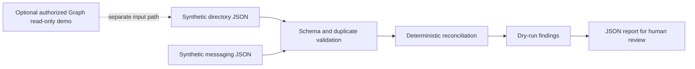

# Architecture

The production boundary is intentional: the Python package reads local fixtures and emits proposals only. It contains no remote client and exposes no write operation. The optional PowerShell script is isolated from the reconciliation path, requires an explicit development-tenant acknowledgement, requests delegated `User.ReadBasic.All`, limits the query to five users, and does not persist results.

## Trust boundaries

- JSON files are untrusted inputs and are validated before reconciliation.
- Identifiers are compared case-insensitively after whitespace normalization.
- Duplicate identities and duplicate memberships stop execution.
- Orphaned mailboxes and unexpected memberships produce manual-review findings; they are never deletion instructions.
- Generated reports may still contain fixture values, so real tenant exports must not be used with this public lab.
